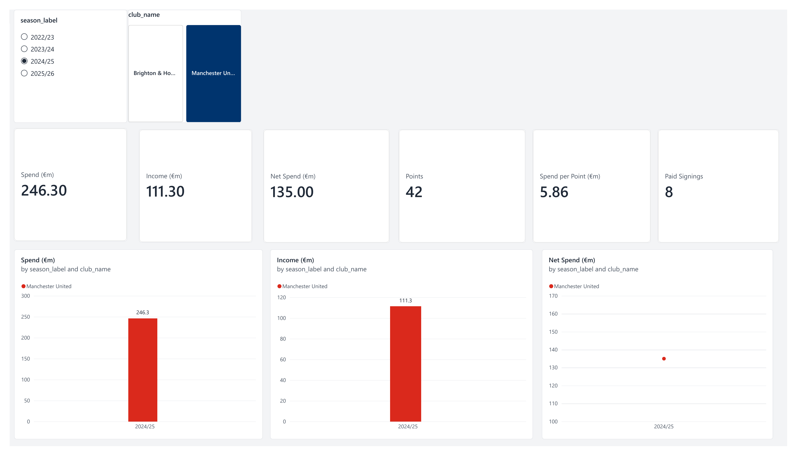
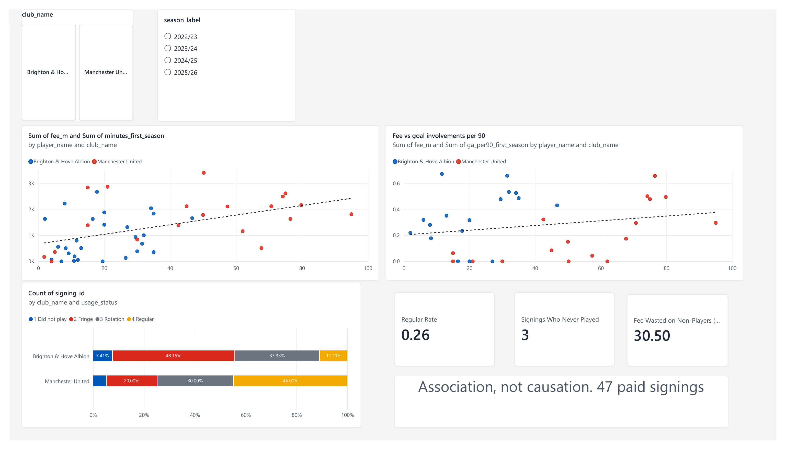
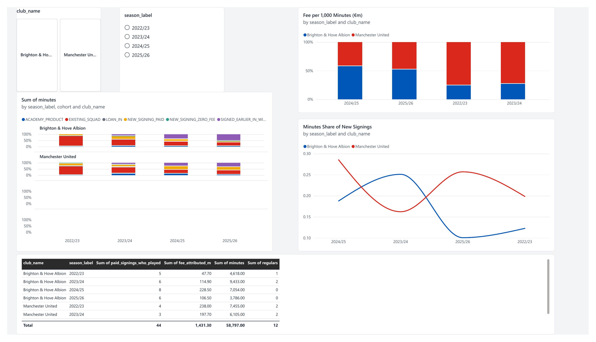
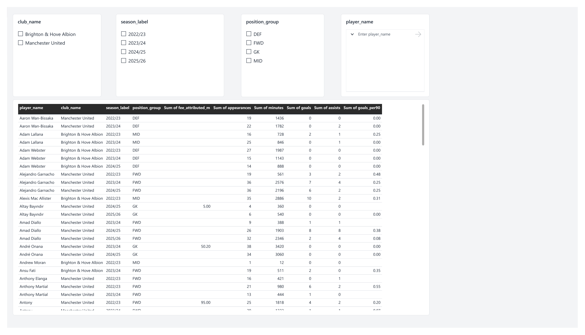
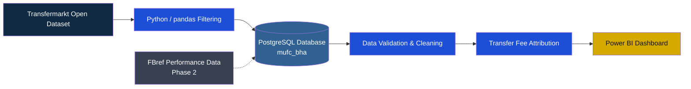

<div align="center">


# 🔴 Red Devils vs Seagulls 🔵

### Does Transfer Money Buy Performance?

**A football data analytics investigation into Manchester United and Brighton & Hove Albion, 2022/23–2025/26.**


**One club spends big. The other buys, develops, and sells.**

*Which club gets more football performance from its transfer investment?*

</div>

---

## 📖 1. The Story Behind the Project

I'm a **Manchester United fan**, so naturally, I've always paid attention to the club's transfers, big signings, and attempts to rebuild a competitive squad.

But something else caught my attention: **Brighton & Hove Albion.**

While United have often been associated with expensive signings and significant transfer spending, Brighton have attracted attention for a different approach — identifying undervalued talent, developing players, and selling them for substantial fees.

That contrast got me thinking:

> Are expensive transfers actually delivering better results, or can a smarter recruitment strategy get more value from the money spent?

As someone interested in both football and data analytics, I decided to investigate rather than rely on opinions, headlines, or fan debates.

Using transfer and Premier League performance data from the **2022/23 to 2025/26 seasons**, this project compares Manchester United and Brighton to explore how effectively they turn transfer investment into playing time and on-pitch contributions.

What started as curiosity as a United fan became a data analytics investigation into recruitment, spending, and performance.

**The question isn't simply who spends more. It's who gets more football value from their investment.**

---

## 🎯 2. The Business Question

> **How effectively do Manchester United and Brighton & Hove Albion convert transfer spending into player usage and on-pitch performance in the Premier League?**

The investigation is organized around four questions:

| # | Research question | What the analysis measures |
|---|---|---|
| 1 | How much did each club spend and earn? | Transfer expenditure, income, and net spend |
| 2 | Did transfer spending buy a place in the team? | First-season minutes played by new signings |
| 3 | Did expensive signings deliver more attacking output? | Transfer fee against goal involvements per 90 |
| 4 | How dependent are the squads on new signings? | Share of squad minutes played by new arrivals |

**The analytical approach:** Follow the money, measure the minutes, examine the output, and understand the limitations.

---

## 🗺️ 3. Project Roadmap

The project is divided into two phases. Phase 1 establishes the financial and basic performance picture. Phase 2 aims to make player-performance comparisons more positionally meaningful.

| Phase | Data source | Main objective | Status |
|---|---|---|---|
| 1 | Transfermarkt | Spending, income, signing usage, and attacking output | ✅ Completed — v1 |
| 2 | FBref | Position-specific player performance and deeper evaluation | 🔜 Planned |

### Phase 1 — Transfermarkt: Following the Money

The first phase uses transfer records and Premier League player statistics to investigate:

- Transfer expenditure and income by season
- Net transfer spending
- How much new signings played in their first season
- Whether transfer fees were associated with attacking output
- The contribution of new signings to total squad minutes

### Phase 2 — FBref: Measuring Performance More Fairly

Phase 1 provides a useful starting point, but it has an important limitation.

Minutes played indicate how much a player was used, not necessarily how well that player performed.

Similarly, goals and assists favour attacking players. A defender or goalkeeper can perform exceptionally well without recording either.

Phase 2 will introduce FBref performance statistics to build a more balanced assessment.

**Planned improvements:**

**1. Position-specific comparisons**

Players will be evaluated within their own position groups:

- Goalkeepers
- Defenders
- Midfielders
- Forwards

**2. Role-appropriate performance metrics**

Examples include:

- Goalkeepers: save percentage and goals prevented, where available
- Defenders: defensive actions, tackles, interceptions, and aerial performance
- Midfielders: passing, progression, possession, and chance creation
- Forwards: goals, shots, shooting efficiency, and attacking contribution

**3. Per-90-minute comparisons**

Performance statistics will be standardized per 90 minutes, with a minimum-minutes threshold to reduce the influence of small samples.

**4. Player matching**

A dedicated matching table will link FBref player records to Transfermarkt player records so that transfer fees can be connected to player performance.

*The Phase 2 metrics and matching rules will be documented in the methodology as implementation progresses.*

---

## 📌 4. What the Data Revealed — Phase 1

<sub>Initial findings from the Transfermarkt analysis. Figures should be verified against the final dashboard and SQL outputs before publication.</sub>

### Key findings

| Indicator | Finding |
|---|---:|
| Paid signings analysed | **47** |
| Played in their first season | **44** |
| Never played in their first season | **3** |
| Spending on signings who never played | **€30.5 million** |
| Paid signings reaching 2,000+ first-season minutes — Man United | **45%** |
| Paid signings reaching 2,000+ first-season minutes — Brighton | **11%** |

### What do these numbers suggest?

**1. Transfer fees do not guarantee playing time.**

Three paid signings never made a Premier League appearance for their clubs in their first season, despite representing a combined €30.5 million in reported transfer expenditure.

**2. Regular involvement differs between the clubs.**

In this sample, 45% of Manchester United's paid signings reached the 2,000-minute regular-player threshold, compared with 11% of Brighton's.

**3. Higher fees do not clearly guarantee higher attacking output.**

The relationship between transfer fees and goal involvements per 90 minutes appears weak. The trend line is shallow, suggesting that a larger fee does not necessarily translate into greater attacking output.

**4. A better performance model is needed.**

Goals and assists alone cannot fairly evaluate defenders and goalkeepers. This is the main motivation behind Phase 2.

### 💡 Current takeaway

Transfer expenditure alone does not tell the full story of recruitment success. The number of minutes a signing earns and the contribution they make on the pitch provide important additional context.

*The findings are descriptive and indicative, not proof that transfer spending causes better or worse performance. The sample contains 47 paid signings.*

---

## 📊 5. The Dashboard — Phase 1

The Power BI dashboard translates the analysis into four views, allowing the financial and sporting dimensions of recruitment to be explored together.

### 💶 Transfer Spending & Income

How much did each club spend, earn, and commit to new players?



### 🎯 Signings vs Performance

Does a higher transfer fee correspond to greater attacking output?



### ⏱️ Squad Minutes by Cohort

How much of each club's playing time comes from new signings compared with other squad players?



### 🧑‍🤝‍🧑 Player Detail

Explore individual player contributions and transfer information.



<sub>The screenshots represent the Phase 1 dashboard. The Power BI project file (.pbix) is not currently included in this repository.</sub>

---

## 🧱 6. Technical Architecture

The project follows an analytics pipeline, moving from raw transfer data to a cleaned relational database and finally to an interactive dashboard.



### Technology stack

| Technology | Purpose |
|---|---|
| Python | Filtering and preparing raw datasets |
| pandas | Data manipulation and transformation |
| PostgreSQL | Relational data storage and querying |
| SQL | Schema creation, relationships, cleaning, and analysis |
| Power BI | Data visualization and dashboard development |
| Git/GitHub | Version control and project documentation |

---

## 🗂️ 7. Repository Structure

```text
.
├── README.md
├── .gitignore
├── requirements.txt
│
├── assets/
│   └── banner.svg
│
├── scripts/
│   └── filter_data.py
│
├── sql/
│   ├── 01_create_schema.sql
│   ├── 02_load_data.sql
│   ├── 03_keys_and_relationships.sql
│   └── ...
│
├── docs/
│   ├── methodology.md
│   ├── data_dictionary.md
│   └── data_model.png
│
├── data/
│   └── README.md
│
└── dashboard/
    └── screenshots/
        ├── 01-spend-income-overview.png
        ├── 02-signings-vs-performance.png
        ├── 03-squad-minutes-cohorts.png
        └── 04-player-detail.png
```

*This structure describes the intended project organization. Additional Phase 2 files will be added as development progresses.*

---

## 🔁 8. Reproducing Phase 1

### Prerequisites

- Python installed
- PostgreSQL installed and running
- Power BI Desktop
- Git
- Raw Transfermarkt dataset files

### Step 1 — Clone the repository

```bash
git clone https://github.com/johnsonnyimbo/YOUR-REPOSITORY-NAME.git

cd YOUR-REPOSITORY-NAME
```

### Step 2 — Install dependencies

```bash
pip install -r requirements.txt
```

### Step 3 — Download the dataset

Download the Transfermarkt files described in `data/README.md`.

Place the downloaded files inside:

```text
data/raw/
```

### Step 4 — Filter the raw data

```bash
python scripts/filter_data.py
```

This generates the filtered CSV files required by the database.

### Step 5 — Create the PostgreSQL database

```sql
CREATE DATABASE mufc_bha;
```

### Step 6 — Run the SQL scripts

Execute the SQL scripts in numeric order.

```bash
psql -U postgres -d mufc_bha -f sql/01_create_schema.sql

psql -U postgres -d mufc_bha -f sql/02_load_data.sql

psql -U postgres -d mufc_bha -f sql/03_keys_and_relationships.sql
```

Continue with the remaining scripts in their documented order.

### Step 7 — Open the dashboard

In Power BI Desktop:

1. Connect to the `mufc_bha` PostgreSQL database.
2. Load the required analytical tables or views.
3. Configure relationships and measures if required.
4. Open the dashboard and explore the results.

*Refer to `docs/` and `data/README.md` for dataset preparation, assumptions, and additional configuration.*

---

## 📐 9. Methodology & Definitions

To make the comparison consistent, the project uses the following definitions.

| Measure | Definition |
|---|---|
| Transfer expenditure | Sum of reported incoming transfer fees greater than zero |
| Transfer income | Sum of reported outgoing transfer fees greater than zero |
| Net spend | Transfer expenditure minus transfer income |
| Regular signing | 2,000+ first-season Premier League minutes |
| Rotation signing | 900–1,999 first-season Premier League minutes |
| Fringe signing | Under 900 first-season Premier League minutes |
| Goal involvements | Goals plus assists |
| Attacking output | Goal involvements per 90 minutes |
| Minimum performance sample | 450+ minutes |

### Important assumptions

- All reported transfer amounts are in euros.
- Zero or missing transfer fees are excluded from paid-transfer expenditure and income calculations.
- First-season usage is measured using Premier League minutes.
- Cup and European competition appearances are excluded.
- Performance comparisons use a 450-minute minimum to reduce the influence of very small samples.

For the complete methodology, including definitions, data preparation, and analytical decisions, see:

- `docs/methodology.md`
- `docs/data_dictionary.md`

<details>
<summary><strong>⚠️ Limitations and considerations</strong></summary>

**Transfer fee accuracy**

Transfer fees are based on reported Transfermarkt values and may differ from officially disclosed transfer amounts.

**Competition coverage**

Only Premier League matches are included. Domestic cup and European competition performances are excluded.

**Attacking bias**

Goals and assists are not suitable as standalone performance measures for defenders and goalkeepers. Phase 2 will introduce position-specific metrics.

**Sample size**

The Phase 1 comparison covers 47 paid signings. Observed relationships should therefore be interpreted cautiously.

**Resale value**

The current Phase 1 model does not account for player resale value, an important part of evaluating Brighton's recruitment strategy.

**Other influences**

League performance is influenced by factors beyond recruitment, including injuries, coaching, tactical systems, player development, and squad availability.

**Correlation and causation**

A relationship between transfer fees and performance does not establish that spending caused a particular outcome.

</details>

---

## 📚 10. Data Sources & Attribution

**Primary source:** Transfermarkt open dataset.

- Dataset repository: [dcaribou/transfermarkt-datasets](https://github.com/dcaribou/transfermarkt-datasets)
- Kaggle dataset: [davidcariboo/player-scores](https://www.kaggle.com/datasets/davidcariboo/player-scores)

Dataset download dates, source files, and filtering decisions are documented in `data/README.md`.

**Phase 2 source:** FBref football statistics.

Relevant data sources, collection dates, and usage considerations will be documented as Phase 2 is implemented.

---

## 🚀 11. Future Development

The next stage of this project is about moving beyond basic financial and attacking comparisons.

- [ ] Integrate FBref performance statistics.
- [ ] Build a player-matching table between Transfermarkt and FBref.
- [ ] Develop position-specific performance measures.
- [ ] Implement per-90-minute comparisons across player roles.
- [ ] Add a minimum playing-time threshold.
- [ ] Extend the dashboard with position-specific player evaluations.
- [ ] Investigate transfer value beyond initial fees, including player resale value.
- [ ] Document the complete analytical findings and final conclusions.

---

## 👤 12. About the Author

**Johnson Nyimbo**

Computer Science student at the Institute of Finance Management, Dar es Salaam, Tanzania.

I'm interested in data analytics, business intelligence, and using data to investigate real-world questions.

**Career focus:** Data Analyst · BI Analyst · Sports Data Analyst

[](https://github.com/johnsonnyimbo)

[](mailto:johnsonnyimbo20@gmail.com)

---

<div align="center">

### Every transfer has a price. But does it deliver performance?

# Let's tell a story using data.

<sub>Manchester United and Brighton & Hove Albion are referenced for identification and analytical comparison only. This is an independent portfolio project and is not affiliated with or endorsed by either club. No official club crests are used. The banner and visual identity are original artwork.</sub>

</div>
